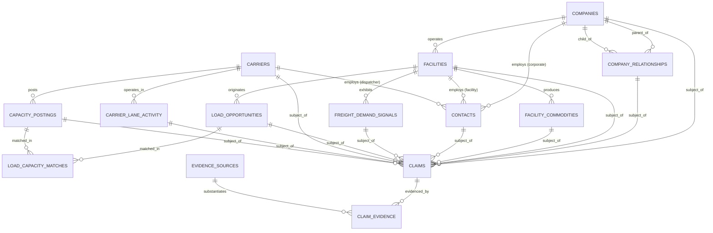

# FreightProspecting V1 — Technical Architecture Specification (Revision 4.1 Frozen)

* **Document Version:** Revision 4.1 (Schema Freeze Baseline)  
* **Storage Location:** `D:\FreightProspecting`  
* **Target Stack:** Python 3.11+, FastAPI, SQLite3 (WAL mode), HTML5 / Vanilla CSS, Alpine.js (v3.14.8 local)

---

## 1. High-Level Entity Relationship Model



---

## 2. Frozen Relational DDL Blueprint

```sql
-- 1. COMPANIES & DATED CORPORATE RELATIONSHIPS
CREATE TABLE companies (
    id INTEGER PRIMARY KEY AUTOINCREMENT,
    operating_brand TEXT NOT NULL,
    legal_name TEXT,
    corporate_address TEXT,
    website_url TEXT,
    notes TEXT,
    created_at DATETIME DEFAULT CURRENT_TIMESTAMP,
    updated_at DATETIME DEFAULT CURRENT_TIMESTAMP
);

CREATE TABLE company_relationships (
    id INTEGER PRIMARY KEY AUTOINCREMENT,
    parent_company_id INTEGER NOT NULL REFERENCES companies(id) ON DELETE CASCADE,
    child_company_id INTEGER NOT NULL REFERENCES companies(id) ON DELETE CASCADE,
    relationship_type TEXT NOT NULL, -- 'ACQUISITION', 'SUBSIDIARY', 'DIVISION', 'HOLDING'
    valid_from DATE,
    valid_to DATE,                   -- NULL indicates currently active relationship
    is_current BOOLEAN NOT NULL DEFAULT 1,
    verification_status TEXT NOT NULL CHECK(verification_status IN ('VERIFIED', 'INFERRED', 'UNKNOWN')),
    notes TEXT,
    created_at DATETIME DEFAULT CURRENT_TIMESTAMP
);

-- 2. OPERATING FACILITIES
CREATE TABLE facilities (
    id INTEGER PRIMARY KEY AUTOINCREMENT,
    company_id INTEGER NOT NULL REFERENCES companies(id) ON DELETE CASCADE,
    facility_name TEXT NOT NULL,
    facility_type TEXT NOT NULL,     -- 'SAWMILL', 'STEEL_SERVICE_CENTER', 'PRECAST_PLANT', 'TOOLING_PLANT'
    physical_address TEXT NOT NULL,
    city TEXT NOT NULL,
    state_prov TEXT NOT NULL,
    postal_code TEXT,
    country TEXT NOT NULL CHECK(country IN ('US', 'CA')),
    latitude REAL,
    longitude REAL,
    -- Materialized operational fields synchronized with accepted claims
    private_fleet_present TEXT NOT NULL DEFAULT 'UNKNOWN' CHECK(private_fleet_present IN ('VERIFIED_PRESENT', 'VERIFIED_NO_FLEET', 'UNKNOWN')),
    vehicle_asset_ownership TEXT NOT NULL DEFAULT 'UNKNOWN' CHECK(vehicle_asset_ownership IN ('VERIFIED_OWNED', 'VERIFIED_LEASED', 'UNKNOWN')),
    broker_friendly_status TEXT NOT NULL DEFAULT 'UNKNOWN' CHECK(broker_friendly_status IN ('VERIFIED_ACCEPTS', 'VERIFIED_DIRECT_ONLY', 'UNKNOWN')),
    freight_procurement_level TEXT NOT NULL DEFAULT 'UNKNOWN' CHECK(freight_procurement_level IN ('FACILITY_LEVEL', 'CORPORATE_PARENT', 'UNKNOWN')),
    created_at DATETIME DEFAULT CURRENT_TIMESTAMP,
    updated_at DATETIME DEFAULT CURRENT_TIMESTAMP
);

-- 3. FACILITY COMMODITIES & EQUIPMENT USAGE
CREATE TABLE facility_commodities (
    id INTEGER PRIMARY KEY AUTOINCREMENT,
    facility_id INTEGER NOT NULL REFERENCES facilities(id) ON DELETE CASCADE,
    commodity_category TEXT NOT NULL,
    specific_products TEXT NOT NULL,
    equipment_category TEXT NOT NULL CHECK(equipment_category IN ('FLATBED', 'STEP_DECK', 'DRY_VAN')),
    equipment_usage_status TEXT NOT NULL CHECK(equipment_usage_status IN ('VERIFIED', 'INFERRED', 'UNKNOWN')),
    trailer_specs_notes TEXT,       -- e.g. '48-ft standard', 'pipe bunks', 'chains & coil racks'
    securement_tarp_notes TEXT,     -- e.g. '4-ft lumber tarps', 'steel tarps'
    created_at DATETIME DEFAULT CURRENT_TIMESTAMP
);

-- 4. GENERALIZED CONTACTS (SHIPPER & CARRIER)
CREATE TABLE contacts (
    id INTEGER PRIMARY KEY AUTOINCREMENT,
    company_id INTEGER REFERENCES companies(id) ON DELETE CASCADE,
    facility_id INTEGER REFERENCES facilities(id) ON DELETE CASCADE,
    carrier_id INTEGER REFERENCES carriers(id) ON DELETE CASCADE,
    contact_identity TEXT NOT NULL CHECK(contact_identity IN ('NAMED_PERSON', 'DEPARTMENT', 'GENERAL_FACILITY')),
    person_name TEXT,
    exact_published_title TEXT,
    department TEXT,
    phone_number TEXT,
    phone_extension TEXT,
    phone_directness TEXT NOT NULL CHECK(phone_directness IN ('DIRECT_PERSON', 'DEPARTMENTAL', 'GENERAL_SWITCHBOARD', 'UNKNOWN')),
    email_address TEXT,
    email_directness TEXT NOT NULL CHECK(email_directness IN ('DIRECT_PERSON', 'DEPARTMENTAL', 'GENERAL_INBOX', 'UNKNOWN')),
    outbound_shipping_procurement_relevance TEXT NOT NULL DEFAULT 'UNKNOWN' CHECK(outbound_shipping_procurement_relevance IN ('VERIFIED', 'INFERRED', 'UNKNOWN')),
    broker_procurement_relevance TEXT NOT NULL DEFAULT 'UNKNOWN' CHECK(broker_procurement_relevance IN ('VERIFIED', 'INFERRED', 'UNKNOWN')),
    is_primary_contact BOOLEAN NOT NULL DEFAULT 0,
    created_at DATETIME DEFAULT CURRENT_TIMESTAMP,
    CHECK (
        (CASE WHEN company_id IS NOT NULL THEN 1 ELSE 0 END +
         CASE WHEN facility_id IS NOT NULL THEN 1 ELSE 0 END +
         CASE WHEN carrier_id IS NOT NULL THEN 1 ELSE 0 END) = 1
    )
);

-- 5. CLAIMS LEDGER (10 PROVENANCE SUBJECTS & SINGLE CURRENT CLAIM ENFORCED)
CREATE TABLE claims (
    id INTEGER PRIMARY KEY AUTOINCREMENT,
    company_id INTEGER REFERENCES companies(id) ON DELETE CASCADE,
    company_relationship_id INTEGER REFERENCES company_relationships(id) ON DELETE CASCADE,
    facility_id INTEGER REFERENCES facilities(id) ON DELETE CASCADE,
    facility_commodity_id INTEGER REFERENCES facility_commodities(id) ON DELETE CASCADE,
    contact_id INTEGER REFERENCES contacts(id) ON DELETE CASCADE,
    freight_demand_signal_id INTEGER REFERENCES freight_demand_signals(id) ON DELETE CASCADE,
    load_opportunity_id INTEGER REFERENCES load_opportunities(id) ON DELETE CASCADE,
    carrier_id INTEGER REFERENCES carriers(id) ON DELETE CASCADE,
    carrier_lane_activity_id INTEGER REFERENCES carrier_lane_activity(id) ON DELETE CASCADE,
    capacity_posting_id INTEGER REFERENCES capacity_postings(id) ON DELETE CASCADE,
    claim_field TEXT NOT NULL,
    claimed_value TEXT NOT NULL,
    verification_status TEXT NOT NULL CHECK(verification_status IN ('VERIFIED', 'INFERRED', 'UNKNOWN')),
    is_current_accepted BOOLEAN NOT NULL DEFAULT 1,
    claim_notes TEXT,
    created_at DATETIME DEFAULT CURRENT_TIMESTAMP,
    updated_at DATETIME DEFAULT CURRENT_TIMESTAMP,
    CHECK (
        (CASE WHEN company_id IS NOT NULL THEN 1 ELSE 0 END +
         CASE WHEN company_relationship_id IS NOT NULL THEN 1 ELSE 0 END +
         CASE WHEN facility_id IS NOT NULL THEN 1 ELSE 0 END +
         CASE WHEN facility_commodity_id IS NOT NULL THEN 1 ELSE 0 END +
         CASE WHEN contact_id IS NOT NULL THEN 1 ELSE 0 END +
         CASE WHEN freight_demand_signal_id IS NOT NULL THEN 1 ELSE 0 END +
         CASE WHEN load_opportunity_id IS NOT NULL THEN 1 ELSE 0 END +
         CASE WHEN carrier_id IS NOT NULL THEN 1 ELSE 0 END +
         CASE WHEN carrier_lane_activity_id IS NOT NULL THEN 1 ELSE 0 END +
         CASE WHEN capacity_posting_id IS NOT NULL THEN 1 ELSE 0 END) = 1
    )
);

-- Partial unique indexes: Exactly one current accepted claim per subject + field
CREATE UNIQUE INDEX uq_current_claim_company ON claims(company_id, claim_field) WHERE is_current_accepted = 1 AND company_id IS NOT NULL;
CREATE UNIQUE INDEX uq_current_claim_comp_rel ON claims(company_relationship_id, claim_field) WHERE is_current_accepted = 1 AND company_relationship_id IS NOT NULL;
CREATE UNIQUE INDEX uq_current_claim_facility ON claims(facility_id, claim_field) WHERE is_current_accepted = 1 AND facility_id IS NOT NULL;
CREATE UNIQUE INDEX uq_current_claim_commodity ON claims(facility_commodity_id, claim_field) WHERE is_current_accepted = 1 AND facility_commodity_id IS NOT NULL;
CREATE UNIQUE INDEX uq_current_claim_contact ON claims(contact_id, claim_field) WHERE is_current_accepted = 1 AND contact_id IS NOT NULL;
CREATE UNIQUE INDEX uq_current_claim_fgt_sig ON claims(freight_demand_signal_id, claim_field) WHERE is_current_accepted = 1 AND freight_demand_signal_id IS NOT NULL;
CREATE UNIQUE INDEX uq_current_claim_load ON claims(load_opportunity_id, claim_field) WHERE is_current_accepted = 1 AND load_opportunity_id IS NOT NULL;
CREATE UNIQUE INDEX uq_current_claim_carrier ON claims(carrier_id, claim_field) WHERE is_current_accepted = 1 AND carrier_id IS NOT NULL;
CREATE UNIQUE INDEX uq_current_claim_lane_act ON claims(carrier_lane_activity_id, claim_field) WHERE is_current_accepted = 1 AND carrier_lane_activity_id IS NOT NULL;
CREATE UNIQUE INDEX uq_current_claim_capacity ON claims(capacity_posting_id, claim_field) WHERE is_current_accepted = 1 AND capacity_posting_id IS NOT NULL;

-- 6. EVIDENCE SOURCES & LINK TABLE
CREATE TABLE evidence_sources (
    id INTEGER PRIMARY KEY AUTOINCREMENT,
    source_type TEXT NOT NULL CHECK(source_type IN ('COMPANY_WEBSITE', 'GOVERNMENT_REGISTRY', 'JOB_POSTING', 'INDUSTRY_DIRECTORY', 'PHONE_OUTREACH', 'EMAIL_CORRESPONDENCE')),
    source_title_publisher TEXT NOT NULL,
    source_url TEXT,                 -- NULLABLE: Phone outreach and offline sources have no URL
    is_primary_source BOOLEAN,       -- NULLABLE: Set when applicable
    source_published_at DATETIME,    -- Publication timestamp (NULL if unknown)
    event_at DATETIME,               -- Timestamp when event occurred/applies (NULL if persistent fact)
    observed_at DATETIME NOT NULL,   -- Timestamp when researcher/system inspected source
    outreach_log_id INTEGER REFERENCES outreach_logs(id) ON DELETE SET NULL,
    notes TEXT,
    created_at DATETIME DEFAULT CURRENT_TIMESTAMP
);

CREATE TABLE claim_evidence (
    id INTEGER PRIMARY KEY AUTOINCREMENT,
    claim_id INTEGER NOT NULL REFERENCES claims(id) ON DELETE CASCADE,
    evidence_source_id INTEGER NOT NULL REFERENCES evidence_sources(id) ON DELETE CASCADE,
    relationship TEXT NOT NULL CHECK(relationship IN ('SUPPORTS', 'CONTRADICTS', 'CONTEXT')),
    relationship_notes TEXT,
    created_at DATETIME DEFAULT CURRENT_TIMESTAMP
);

-- 7. FREIGHT DEMAND SIGNALS (SEPARATED FROM DISCRETE LOADS)
CREATE TABLE freight_demand_signals (
    id INTEGER PRIMARY KEY AUTOINCREMENT,
    facility_id INTEGER NOT NULL REFERENCES facilities(id) ON DELETE CASCADE,
    signal_type TEXT NOT NULL CHECK(signal_type IN ('RFP', 'TENDER', 'DATED_LOAD_POSTING', 'QUOTE_REQUEST', 'SHIPMENT_PROCUREMENT_NOTICE', 'DIRECT_CONFIRMATION')),
    signal_status TEXT NOT NULL CHECK(signal_status IN ('HISTORICAL_SIGNAL', 'SIGNAL_LAST_30_DAYS', 'EXPIRED')),
    origin_city TEXT,
    origin_state_prov TEXT,
    origin_country TEXT CHECK(origin_country IS NULL OR origin_country IN ('US', 'CA')),
    dest_city TEXT,
    dest_state_prov TEXT,
    dest_country TEXT CHECK(dest_country IS NULL OR dest_country IN ('US', 'CA')),
    commodity_notes TEXT,
    equipment_indication TEXT CHECK(equipment_indication IS NULL OR equipment_indication IN ('FLATBED', 'STEP_DECK', 'DRY_VAN')),
    event_at DATETIME,               -- NULLABLE for undated historical signals; MANDATORY for SIGNAL_LAST_30_DAYS
    observed_at DATETIME NOT NULL,   -- Date/time signal was checked
    expires_at DATETIME,             -- Signal expiration timestamp
    notes TEXT,
    created_at DATETIME DEFAULT CURRENT_TIMESTAMP
);

-- 8. LOAD OPPORTUNITIES (STATE-DEPENDENT VALIDATION)
CREATE TABLE load_opportunities (
    id INTEGER PRIMARY KEY AUTOINCREMENT,
    facility_id INTEGER NOT NULL REFERENCES facilities(id) ON DELETE CASCADE,
    load_status TEXT NOT NULL CHECK(load_status IN ('IDENTIFIED', 'CONFIRMED_AVAILABLE_NOW', 'COVERED', 'LOST', 'CANCELLED', 'EXPIRED')),
    origin_city TEXT,                -- NULLABLE in IDENTIFIED; Enforced NOT NULL in CONFIRMED_AVAILABLE_NOW
    origin_state_prov TEXT,          -- NULLABLE in IDENTIFIED; Enforced NOT NULL in CONFIRMED_AVAILABLE_NOW
    origin_country TEXT CHECK(origin_country IS NULL OR origin_country IN ('US', 'CA')),
    dest_city TEXT,                  -- NULLABLE in IDENTIFIED; Enforced NOT NULL in CONFIRMED_AVAILABLE_NOW
    dest_state_prov TEXT,            -- NULLABLE in IDENTIFIED; Enforced NOT NULL in CONFIRMED_AVAILABLE_NOW
    dest_country TEXT CHECK(dest_country IS NULL OR dest_country IN ('US', 'CA')),
    pickup_date_earliest DATE,       -- Enforced NOT NULL in CONFIRMED_AVAILABLE_NOW
    pickup_date_latest DATE,
    delivery_date_earliest DATE,
    delivery_date_latest DATE,
    equipment_required TEXT CHECK(equipment_required IS NULL OR equipment_required IN ('FLATBED', 'STEP_DECK', 'DRY_VAN')),
    trailer_specs_required TEXT,
    weight_lbs INTEGER,
    dimensions_notes TEXT,
    securement_tarps_notes TEXT,
    shipper_target_rate NUMERIC,     -- NULLABLE: Margin is UNKNOWN if NULL
    carrier_target_cost NUMERIC,     -- NULLABLE: Margin is UNKNOWN if NULL
    gross_margin NUMERIC,            -- Synchronized: shipper_target_rate - carrier_target_cost
    margin_pct NUMERIC,              -- Synchronized: (gross_margin / shipper_target_rate) * 100
    confirmed_at DATETIME,           -- Mandatory in CONFIRMED_AVAILABLE_NOW
    last_reconfirmed_at DATETIME,
    expires_at DATETIME,             -- Mandatory in CONFIRMED_AVAILABLE_NOW
    event_at DATETIME,               -- Mandatory in CONFIRMED_AVAILABLE_NOW
    observed_at DATETIME NOT NULL,
    created_at DATETIME DEFAULT CURRENT_TIMESTAMP
);

-- 9. CARRIERS, HISTORICAL LANE ACTIVITY, & CAPACITY POSTINGS
CREATE TABLE carriers (
    id INTEGER PRIMARY KEY AUTOINCREMENT,
    legal_name TEXT NOT NULL,
    dba_name TEXT,
    usdot_number TEXT UNIQUE,
    mc_number TEXT,
    physical_city TEXT,
    physical_state_prov TEXT,
    country TEXT NOT NULL CHECK(country IN ('US', 'CA')),
    safety_rating TEXT NOT NULL DEFAULT 'UNKNOWN' CHECK(safety_rating IN ('VERIFIED_SATISFACTORY', 'VERIFIED_CONDITIONAL', 'VERIFIED_UNSATISFACTORY', 'VERIFIED_NOT_RATED', 'UNKNOWN')),
    operating_status TEXT NOT NULL DEFAULT 'UNKNOWN' CHECK(operating_status IN ('VERIFIED_AUTHORIZED', 'VERIFIED_NOT_AUTHORIZED', 'VERIFIED_OUT_OF_SERVICE', 'UNKNOWN')),
    cross_border_capability TEXT NOT NULL DEFAULT 'UNKNOWN' CHECK(cross_border_capability IN ('US_ONLY', 'CANADA_ONLY', 'US_CANADA_CAPABLE', 'UNKNOWN')),
    primary_equipment_types TEXT,    -- JSON array: ['FLATBED', 'STEP_DECK']
    fleet_power_units INTEGER,
    preferred_lanes_notes TEXT,
    created_at DATETIME DEFAULT CURRENT_TIMESTAMP
);

CREATE TABLE carrier_lane_activity (
    id INTEGER PRIMARY KEY AUTOINCREMENT,
    carrier_id INTEGER NOT NULL REFERENCES carriers(id) ON DELETE CASCADE,
    origin_country TEXT CHECK(origin_country IS NULL OR origin_country IN ('US', 'CA')),
    origin_region TEXT NOT NULL,     -- State, province, or geographic corridor
    dest_country TEXT CHECK(dest_country IS NULL OR dest_country IN ('US', 'CA')),
    dest_region TEXT NOT NULL,
    equipment_type TEXT CHECK(equipment_type IS NULL OR equipment_type IN ('FLATBED', 'STEP_DECK', 'DRY_VAN')),
    activity_type TEXT NOT NULL,     -- 'HISTORICAL_MOVE', 'INSPECTION_RECORD', 'DISPATCHER_PREFERRED'
    observed_at DATETIME NOT NULL,
    notes TEXT,
    created_at DATETIME DEFAULT CURRENT_TIMESTAMP
);

CREATE TABLE capacity_postings (
    id INTEGER PRIMARY KEY AUTOINCREMENT,
    carrier_id INTEGER NOT NULL REFERENCES carriers(id) ON DELETE CASCADE,
    dispatcher_contact_id INTEGER REFERENCES contacts(id) ON DELETE SET NULL,
    capacity_status TEXT NOT NULL CHECK(capacity_status IN ('POSTED_TENTATIVE', 'TRUCK_CONFIRMED_AVAILABLE_NOW', 'COVERED_BOOKED', 'EXPIRED')),
    available_city TEXT NOT NULL,
    available_state_prov TEXT NOT NULL,
    available_country TEXT NOT NULL CHECK(available_country IN ('US', 'CA')),
    available_date_start DATE NOT NULL,
    available_date_end DATE,
    equipment_type TEXT NOT NULL CHECK(equipment_type IN ('FLATBED', 'STEP_DECK', 'DRY_VAN')),
    trailer_specs_capability TEXT,
    weight_capability_lbs INTEGER,   -- NULLABLE: Not forced into unknown state
    destination_preference_notes TEXT,
    confirmed_at DATETIME,           -- Mandatory when TRUCK_CONFIRMED_AVAILABLE_NOW
    last_reconfirmed_at DATETIME,
    expires_at DATETIME,             -- Mandatory when TRUCK_CONFIRMED_AVAILABLE_NOW
    event_at DATETIME NOT NULL,      -- Actual truck readiness date/window
    observed_at DATETIME NOT NULL,
    created_at DATETIME DEFAULT CURRENT_TIMESTAMP
);

-- 10. SPECIFIC LOAD <-> CAPACITY MATCHES (TRI-STATE COMPATIBILITY)
CREATE TABLE load_capacity_matches (
    id INTEGER PRIMARY KEY AUTOINCREMENT,
    load_opportunity_id INTEGER NOT NULL REFERENCES load_opportunities(id) ON DELETE CASCADE,
    capacity_posting_id INTEGER NOT NULL REFERENCES capacity_postings(id) ON DELETE CASCADE,
    match_status TEXT NOT NULL DEFAULT 'PROPOSED' CHECK(match_status IN ('PROPOSED', 'ACCEPTED', 'REJECTED', 'EXPIRED')),
    equipment_compatibility TEXT NOT NULL DEFAULT 'UNKNOWN' CHECK(equipment_compatibility IN ('COMPATIBLE', 'INCOMPATIBLE', 'UNKNOWN')),
    lane_compatibility TEXT NOT NULL DEFAULT 'UNKNOWN' CHECK(lane_compatibility IN ('COMPATIBLE', 'INCOMPATIBLE', 'UNKNOWN')),
    timing_compatibility TEXT NOT NULL DEFAULT 'UNKNOWN' CHECK(timing_compatibility IN ('COMPATIBLE', 'INCOMPATIBLE', 'UNKNOWN')),
    weight_dim_compatibility TEXT NOT NULL DEFAULT 'UNKNOWN' CHECK(weight_dim_compatibility IN ('COMPATIBLE', 'INCOMPATIBLE', 'UNKNOWN')),
    cross_border_compatibility TEXT NOT NULL DEFAULT 'UNKNOWN' CHECK(cross_border_compatibility IN ('COMPATIBLE', 'INCOMPATIBLE', 'UNKNOWN')),
    estimated_carrier_cost NUMERIC,
    match_reasoning TEXT NOT NULL,
    created_at DATETIME DEFAULT CURRENT_TIMESTAMP,
    updated_at DATETIME DEFAULT CURRENT_TIMESTAMP
);

-- 11. SCOPED SUPPRESSION RECORDS (EXPANDED LANE SCOPE & GEOGRAPHY)
CREATE TABLE suppressions (
    id INTEGER PRIMARY KEY AUTOINCREMENT,
    scope_type TEXT NOT NULL CHECK(scope_type IN ('COMPANY', 'FACILITY', 'COMPANY_LANE', 'FACILITY_LANE', 'GLOBAL_LANE')),
    company_id INTEGER REFERENCES companies(id) ON DELETE CASCADE,
    facility_id INTEGER REFERENCES facilities(id) ON DELETE CASCADE,
    origin_country TEXT CHECK(origin_country IS NULL OR origin_country IN ('US', 'CA')),
    origin_state_prov TEXT,
    origin_city TEXT,
    dest_country TEXT CHECK(dest_country IS NULL OR dest_country IN ('US', 'CA')),
    dest_state_prov TEXT,
    dest_city TEXT,
    suppression_status TEXT NOT NULL CHECK(suppression_status IN ('NORMAL_PROSPECT', 'EXISTING_CUSTOMER', 'ALREADY_ROUTED', 'DO_NOT_CONTACT')),
    reason_notes TEXT NOT NULL,
    assigned_by TEXT NOT NULL DEFAULT 'USER',
    effective_date DATETIME DEFAULT CURRENT_TIMESTAMP,
    CHECK (
        (scope_type = 'COMPANY' AND company_id IS NOT NULL AND facility_id IS NULL AND origin_state_prov IS NULL) OR
        (scope_type = 'FACILITY' AND facility_id IS NOT NULL AND company_id IS NULL AND origin_state_prov IS NULL) OR
        (scope_type = 'COMPANY_LANE' AND company_id IS NOT NULL AND origin_state_prov IS NOT NULL AND dest_state_prov IS NOT NULL) OR
        (scope_type = 'FACILITY_LANE' AND facility_id IS NOT NULL AND origin_state_prov IS NOT NULL AND dest_state_prov IS NOT NULL) OR
        (scope_type = 'GLOBAL_LANE' AND company_id IS NULL AND facility_id IS NULL AND origin_state_prov IS NOT NULL AND dest_state_prov IS NOT NULL)
    )
);

-- 12. GENERALIZED OUTREACH LOGS & SETTINGS
CREATE TABLE outreach_logs (
    id INTEGER PRIMARY KEY AUTOINCREMENT,
    company_id INTEGER REFERENCES companies(id) ON DELETE CASCADE,
    facility_id INTEGER REFERENCES facilities(id) ON DELETE CASCADE,
    carrier_id INTEGER REFERENCES carriers(id) ON DELETE CASCADE,
    contact_id INTEGER REFERENCES contacts(id) ON DELETE SET NULL,
    freight_demand_signal_id INTEGER REFERENCES freight_demand_signals(id) ON DELETE SET NULL,
    load_opportunity_id INTEGER REFERENCES load_opportunities(id) ON DELETE SET NULL,
    capacity_posting_id INTEGER REFERENCES capacity_postings(id) ON DELETE SET NULL,
    outreach_channel TEXT NOT NULL CHECK(outreach_channel IN ('PHONE', 'EMAIL', 'IN_PERSON')),
    outcome TEXT NOT NULL CHECK(outcome IN ('CONNECTED_DECISION_MAKER', 'CONNECTED_GATEKEEPER', 'LEFT_VOICEMAIL', 'NO_ANSWER', 'NOT_INTERESTED', 'WRONG_CONTACT')),
    shipping_procurement_findings TEXT,
    broker_policy_findings TEXT,
    private_fleet_findings TEXT,
    notes TEXT,
    contacted_at DATETIME DEFAULT CURRENT_TIMESTAMP,
    follow_up_date DATE,
    CHECK (
        company_id IS NOT NULL OR
        facility_id IS NOT NULL OR
        carrier_id IS NOT NULL
    )
);

CREATE TABLE settings (
    setting_key TEXT PRIMARY KEY,
    setting_value TEXT NOT NULL,
    value_type TEXT NOT NULL CHECK(value_type IN ('BOOLEAN', 'INTEGER', 'FLOAT', 'STRING', 'JSON')),
    description TEXT
);
```

---

## 3. Commercial Evaluation Engines

The application calculates three distinct, independent metrics:

1. **Prospect Priority Score (0 to 100):** Evaluates facility prospecting value based on commodity fit, equipment usage verification, geographic lane fit, shipping demand signals, and private fleet status.
2. **Conversion Ease Estimate (0 to 100 / Low-Med-High):** Heuristic indicating likelihood/ease of winning brokered freight based on verified broker policy, contact directness, and phone outreach outcomes. Strictly an explainable heuristic, never a proven probability.
3. **Known Gross Margin (\$ and %):** Calculated strictly as $\text{Shipper Target Rate} - \text{Carrier Target Cost}$. Missing either rate yields `Margin = UNKNOWN`. Missing rates never demote an opportunity.

`UNKNOWN` claims **always contribute exactly 0 points** across all scoring calculations.

---

## 4. Local Execution Boundaries, AI Exclusions & Ingestion Pathways

### Confirmed No-Paid-AI-API Standard
FreightProspecting V1 **does not require and does not depend on**:
* Gemini Developer API or OpenAI API
* Google Search API or programmable search engines
* Paid AI APIs or recurring LLM subscription keys
* Any user-provided AI API credentials

All core features — searching/viewing prospects, claims provenance, call logging, scoring, suppression, gross margin calculation, load tracking, carrier capacity matching, and backups — are executed 100% locally in Python and SQLite without AI dependencies.

### Information Ingestion Pathways
1. **Manual Browser Research:** Opening ordinary search queries or company URLs in the user's standard desktop web browser.
2. **Public Permitted Structured Sources:** Automated or scheduled ingestion of public CSV/ZIP/JSON datasets (e.g. daily FMCSA Census, state forestry directories) and free documented public APIs (DOT DataHub).
3. **User-Entered Operational Records:** Phone calls, emails, dispatcher conversations, and manual operational notes.
4. **Optional External Gemini Browser Research:** The user may use Google Gemini in an external consumer browser window (e.g. via personal Google AI Pro). The local app provides copy-prompt and paste-result helpers, but does **not** automate consumer logins and does not interact with the Gemini website programmatically.
5. **Future Optional Licensed Connectors:** Paid load boards or carrier TMS integrations, deferred until the user explicitly obtains authorized API access.

### Execution Boundaries
* **100% Local / Offline Functionality:**
  * Navigating and rendering all UI screens.
  * Local CSS and locally vendored Alpine.js interactivity.
  * Querying, searching, and updating the local SQLite database on `D:`.
  * Calculating Priority, Conversion Ease, and Gross Margin.
  * Logging calls, updating contact directness, recording loads, and matching capacity.
  * Deterministic expiry and recency calculations upon read/startup.
* **Requires Active Internet Connection:**
  * Querying the official FMCSA Developer REST API or downloading public open-data files.
  * Launching external source URLs or search queries in the user's desktop browser.
  * Conducting telephone outreach or sending outbound emails.

---

## 5. Security Architecture & Loopback Isolation

1. **Loopback-Only Interface Binding**:
   - The Uvicorn ASGI server and FastAPI backend bind exclusively to `127.0.0.1` (loopback).
   - The application does not listen on `0.0.0.0` or open network ports to external network interfaces, preventing LAN or WAN access.

2. **Mutation Origin Verification (CSRF Protection)**:
   - State-changing HTTP mutations (`POST`, `PUT`, `DELETE`, `PATCH`) are guarded by `verify_mutation_origin`.
   - The guard verifies the incoming `Origin` and `Referer` headers against allowed local loopback hosts (`127.0.0.1`, `localhost`).
   - Requests from untrusted external web pages attempting cross-origin requests are rejected with `403 Forbidden`.

3. **Self-Contained Client Assets**:
   - All styling and client-side JavaScript (including vendored Alpine.js v3.14.8 at `static/js/vendor/alpine.min.js`) are served directly from the local filesystem.
   - Zero external Content Delivery Networks (CDNs) or third-party tracking scripts are loaded.

4. **URL Sanitization & Safe Protocol Filtering**:
   - External hyperlinks rendered in the interface (such as evidence source citations and corporate website URLs) are filtered through `sanitize_url`.
   - Only `http://` and `https://` schemes are permitted; hazardous schemes (`javascript:`, `data:`, `file:`) and invalid values are blocked or suppressed, preventing cross-site scripting (XSS) and malformed `href="None"` attributes.

---

## 6. Three-Dimensional Time Semantics & Operational Clocks

1. **Explicit Tri-Temporal Dimensionality**:
   - `source_published_at`: Canonical ISO-8601 timestamp when the primary source document/article was officially published by the originating organization.
   - `event_at`: Canonical ISO-8601 timestamp when the real-world operational event physically occurred. Persistent company facts (e.g. corporate headquarters address) carry `event_at = NULL`. Text placeholders like "Active", "Current", or "N/A" are strictly prohibited in timestamp fields.
   - `observed_at`: Canonical ISO-8601 timestamp when the information was gathered, verified, or ingested into the system.

2. **Historical Fidelity vs. Fresh Operational Clocks**:
   - Audited historical seed datasets, evidence records, and claims retain their truthful historical timestamps without artificial modernization or clock-spoofing.
   - New operational records (such as call logs, load postings, capacity notes, and stage promotion history) capture live UTC timestamps generated via `get_current_utc_timestamp()`.
   - Follow-up scheduling combines the operator's chosen local calendar date and time with their local browser timezone into a canonical UTC ISO-8601 `follow_up_at` timestamp.

